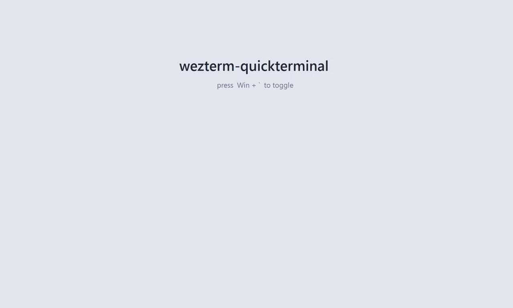

# wezterm-quickterminal

A quick terminal for [WezTerm](https://wezfurlong.org/wezterm/) on Windows: press **Win+`** and a WezTerm window drops down; press it again to hide it.



## Install

Add this to your `.wezterm.lua`, before `return config`:

```lua
local quickterminal = wezterm.plugin.require("https://github.com/iskandarovBakshi/wezterm-quickterminal")
quickterminal.apply_to_config(config)
```

Reload WezTerm and press Win+`.

## Options

Pass a table as the second argument, e.g. `quickterminal.apply_to_config(config, { height = 50 })`.

| Option | Default | |
| --- | --- | --- |
| `hotkey` | `` "Win+`" `` | e.g. `"Ctrl+Alt+T"`, `"F12"` |
| `position` | `"bottom"` | `"bottom"` or `"top"` |
| `height` | `40` | % of the screen, 10–100 |
| `hide_on_focus_loss` | `true` | hide when another app takes focus |
| `autostart` | `false` | start at Windows login |

Hotkey not working? Another app may own it (Windows Terminal uses Win+` by default). Log: `%APPDATA%\wezterm-quickterminal\wezterm-quickterminal.log`

## Uninstall

1. If you set `autostart = true`, change it to `false` and reload WezTerm once.
2. Remove the two quickterminal lines from `.wezterm.lua`.
3. Stop the helper and clean up (PowerShell):

```powershell
Get-CimInstance Win32_Process -Filter "Name='powershell.exe'" |
  Where-Object CommandLine -like '*quickterminal.ps1*' |
  ForEach-Object { Stop-Process -Id $_.ProcessId }
reg delete HKCU\Software\Microsoft\Windows\CurrentVersion\Run /v wezterm-quickterminal /f 2>$null
Remove-Item -Recurse -Force -ErrorAction SilentlyContinue `
  "$env:LOCALAPPDATA\wezterm-quickterminal", "$env:APPDATA\wezterm-quickterminal",
  "$env:APPDATA\wezterm\plugins\*wezterm-quickterminal*"
```

## License

MIT
